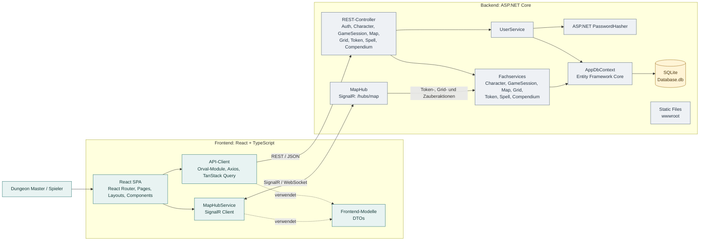

# Systemarchitektur

Im lokalen Entwicklungsbetrieb leitet der Vite-Proxy API- und Hub-Aufrufe an das Backend weiter. `VITE_API_URL` bestimmt die Backend-Adresse. Swagger ist im Backend nur in der Development-Umgebung aktiviert.